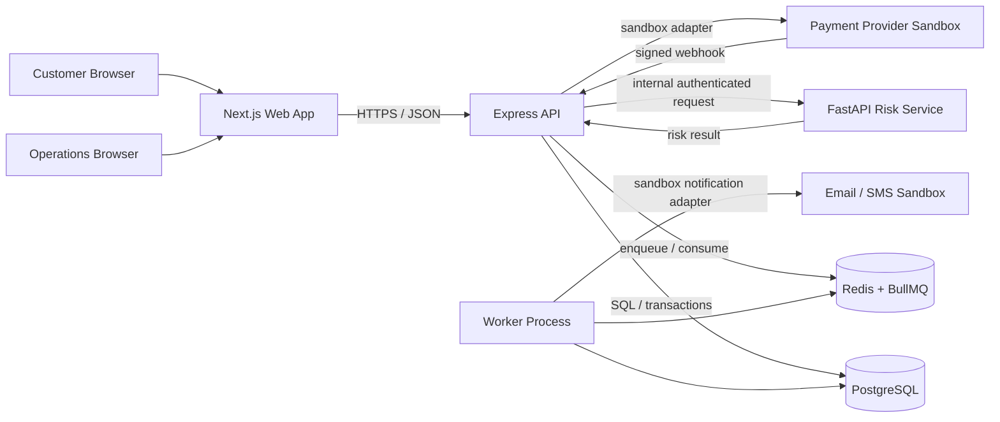
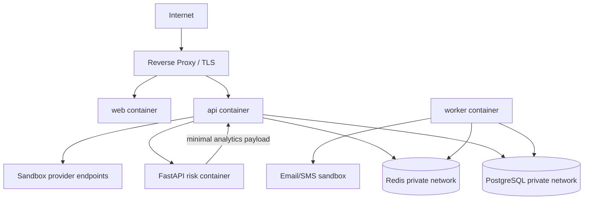
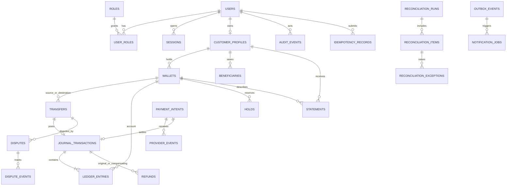
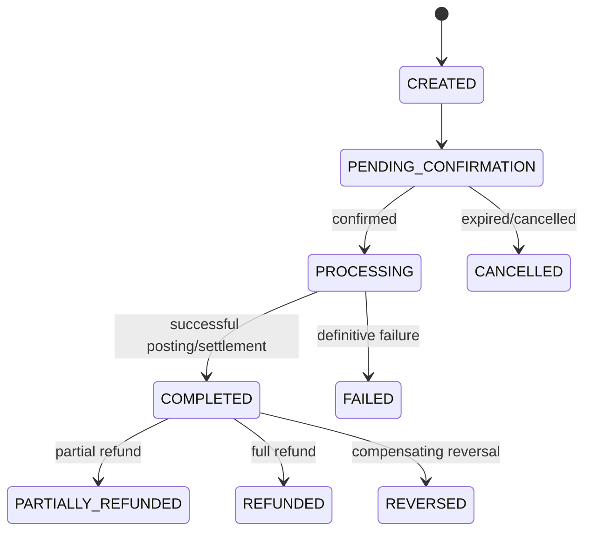

# FinCore — System Design Architecture

## 1. Document control

- System: FinCore
- Purpose: Educational simulation of a digital wallet, ledger and payment-processing platform
- Status: Proposed reference architecture; implementation details must be kept in sync with the code
- Source requirements: FinCore Learner Project Brief, Version 1.0
- Safety boundary: synthetic data and sandbox services only; no real funds or banking credentials

## 2. Goals and non-goals

### Goals
- Support customer wallet/account management, beneficiaries, transfers, payment intents, statements and disputes.
- Provide double-entry accounting with immutable posted ledger entries.
- Provide secure role-based customer and operations experiences.
- Process sandbox provider events with signature verification and deduplication.
- Reconcile provider events/settlement data against internal records.
- Provide FastAPI risk analytics using synthetic transaction data.
- Demonstrate reliability under retries, concurrency, failures and process restarts.
- Deliver tests, API documentation, Docker, CI/CD, deployment and recovery evidence for all 15 assessments.

### Non-goals
- Real-money movement or production banking.
- Real identity verification, KYC/AML certification or regulatory compliance.
- Real bank-account credential collection.
- Production fraud determination. Risk scores are decision support only.
- Real payment provider activation unless separately approved and configured in sandbox mode.

## 3. Architecture decisions

| Concern | Decision | Rationale |
|---|---|---|
| Overall style | Modular monolith + separate analytics service | Manageable for a learner project while preserving required service boundary |
| Frontend | Next.js App Router + TypeScript | Required typed responsive React/Next UI |
| Core API | Express + TypeScript | Single authority for business rules and financial writes |
| Analytics | FastAPI + Pydantic | Explicitly bounded Python service for risk analytics/calculations |
| System of record | PostgreSQL | ACID transactions, constraints, indexing and durable records |
| ORM | Prisma (or justified SQL layer) | Typed data access and migrations; use raw SQL for locking/advanced constraints as needed |
| Queue | Redis + BullMQ | Retryable notifications, outbox dispatch and reconciliation jobs |
| API style | REST `/api/v1` + OpenAPI | Clear contracts and Postman testing |
| Auth | Short-lived access + rotating refresh + RBAC | Revocable sessions and server-side authorization |
| Money | Canonical integer minor units or exact decimal | Avoid binary floating-point errors |
| Deployment | Docker Compose initially; cloud VM/managed hosting later | Reproducible local and production-like environment |

## 4. System context



The browser never connects directly to PostgreSQL, Redis, the provider, or FastAPI. All customer-facing and operations actions pass through Express authorization and domain services.

## 5. Deployment/container view



Container expectations:
- Run as non-root users.
- Keep PostgreSQL and Redis on private internal networks.
- Persist database data with named volumes and backups.
- Configure health checks and graceful shutdown.
- Inject secrets at runtime; do not bake them into images.
- Use multi-stage builds and pinned dependencies.
- Apply HTTPS at the reverse proxy in deployed environments.
- Restrict database ingress to application/worker networks.

## 6. Service responsibilities and data ownership

### Next.js web
- Renders customer and operations dashboards.
- Performs client-side usability validation.
- Calls versioned Express APIs.
- Displays simulated balance and transaction states.
- Does not enforce security or own financial rules.

### Express API
The authoritative business boundary. Owns:
- users, roles, sessions and customer profiles
- wallets/accounts and beneficiaries
- transfers and payment intents
- journal transactions, ledger entries, holds and balance projections
- refunds, reversals and disputes
- webhook inbox and provider references
- reconciliation runs/items/exceptions
- audit events and statement metadata
- risk assessment/alert records received from FastAPI
- idempotency and outbox records

### FastAPI risk service
- Receives minimal validated synthetic transaction features.
- Computes velocity windows, amount deviation and configurable risk rules.
- Returns typed scores, rule hits and explanations.
- Does not create transfers, debit/credit wallets, or post ledger entries.
- Should be stateless for initial delivery; optional service-local cache must not become authoritative financial storage.

### Worker
- Dispatches transactional outbox events.
- Sends sandbox email/SMS notifications.
- Executes retryable reconciliation/import jobs and statement export jobs.
- Handles retry limits and dead-letter/recovery workflow.
- Does not bypass domain services for financial posting.

## 7. Core domain model

### Main entities

| Entity | Purpose | Key relationships |
|---|---|---|
| User | Login identity and account status | roles, sessions, customer profile |
| Role / UserRole | Authorization grants | user |
| Session / RefreshToken | Revocable authentication lifecycle | user |
| CustomerProfile | Customer-facing profile data | user |
| Wallet | Simulated financial account | customer, currency, ledger account |
| Beneficiary | Approved destination relationship | owner customer, destination reference |
| Transfer | Transfer lifecycle and idempotency reference | source/destination wallet, journal |
| JournalTransaction | Accounting event header | ledger entries, transfer/payment/refund |
| LedgerEntry | Immutable debit/credit line | journal, wallet/ledger account |
| Hold | Funds reserved but not finally posted | wallet, transfer/payment |
| PaymentIntent | Provider payment request state | customer/wallet, provider events |
| ProviderEvent | Verified provider webhook inbox | payment intent |
| Refund / Reversal | Compensating financial action | original transaction, journal |
| Dispute / DisputeEvent | Case management lifecycle | customer, transfer/payment |
| ReconciliationRun | One reconciliation execution | items and exceptions |
| ReconciliationItem | Normalized provider/internal item | run |
| ReconciliationException | Mismatch needing review | run/item, resolution audit |
| RiskAssessment / RiskAlert | Analytics outcome and operations alert | transaction/customer |
| Statement | Statement period/export metadata | wallet/customer |
| AuditEvent | Append-only security/business history | actor and target |
| IdempotencyRecord | Deduplicates retryable commands | actor, key, request hash |
| OutboxEvent | Reliable post-commit work | aggregate/resource |
| NotificationJob | Delivery status | user and outbox event |

### ER diagram (logical)



The ERD is logical, not a complete migration specification. Define exact columns, nullability, indexes, check constraints, delete policies and enum values in `DATA_MODEL.md` and migrations.

## 8. Ledger and money design

### Accounting model
Use a journal transaction as the accounting event header and ledger entries as immutable lines. Each posted journal must balance:

\[
\sum \text{debits} = \sum \text{credits}
\]

Balance by currency; never net unrelated currencies. A journal is either pending/unposted or posted. Once posted, its entries cannot be edited or deleted.

For a customer-to-customer transfer of 1,000.00 units:
- Debit source wallet liability by 1,000.00 (customer wallet liability decreases).
- Credit destination wallet liability by 1,000.00 (customer wallet liability increases).

The exact debit/credit normal balance conventions must be documented consistently. Internal accounting accounts may be used for fees, clearing and settlement.

### Monetary representation
Choose one canonical strategy:
- Integer minor units for a defined currency set (e.g. INR paise), or
- PostgreSQL `NUMERIC` with exact decimal library and explicit currency scale.

Do not use JavaScript `number` or Python `float` for money. Use Python `Decimal`. Define rounding mode and fee/interest calculation policy. Every amount includes ISO currency code.

### Available balance
Document one approach:
1. Derive balance from posted ledger entries and active holds; or
2. Maintain a transactional, rebuildable balance projection.

For performance, a projection is reasonable, but it must update in the same transaction as ledger postings and be reconcilable against the ledger. Never trust a browser-provided balance.

### Immutability
- Posted ledger entries are append-only.
- Reversal creates a new journal linked to the original.
- Refunds may be partial, but cumulative refunded amount cannot exceed refundable amount.
- Financial and audit records must not cascade-delete when a user is deleted/deactivated.
- Restrict database role permissions on ledger tables where feasible.

## 9. Transfer consistency and concurrency

### Transfer command sequence

```mermaid
sequenceDiagram
    actor Customer
    participant Web as Next.js
    participant API as Express API
    participant DB as PostgreSQL
    participant Q as Outbox/Worker

    Customer->>Web: Submit transfer + confirmation
    Web->>API: POST /api/v1/transfers + Idempotency-Key
    API->>API: Authenticate, authorize, validate payload
    API->>DB: Begin transaction; reserve/check idempotency
    API->>DB: Lock source and destination wallets in sorted order
    API->>DB: Check status, currency, limits and available funds
    API->>DB: Insert transfer + balanced journal + ledger entries
    API->>DB: Update balance projection + audit + outbox
    API->>DB: Commit
    API-->>Web: Transfer resource and state
    DB-->>Q: Outbox event becomes available
    Q->>Q: Send notification idempotently
```

Implementation controls:
1. Require a client idempotency key for retryable create operations.
2. Bind key to actor, operation and canonical request hash.
3. Same key + same request returns original result; same key + different request returns 409.
4. Begin database transaction.
5. Lock affected wallet rows in deterministic order (`ORDER BY id FOR UPDATE`) to avoid deadlocks.
6. Re-check wallet status, currency, available balance and limits while locks are held.
7. Create transfer and journal header.
8. Create equal debit and credit entries.
9. Update projection, audit event and outbox record in the same transaction.
10. Commit before sending notifications or calling external systems.

For transfers involving external payment rails, use a state machine and saga/outbox pattern; never hold a DB transaction open during provider network calls.

### State machine (example)



Use separate state machines where payment intents, disputes and reconciliation cases have different semantics. Validate all transitions in backend domain services.

## 10. Payment intent and webhook processing

```mermaid
sequenceDiagram
    participant C as Customer
    participant A as Express API
    participant DB as PostgreSQL
    participant PSP as Provider Sandbox

    C->>A: Create payment intent
    A->>DB: Persist local intent (CREATED)
    A->>PSP: Create sandbox session (outside DB transaction)
    PSP-->>A: Provider reference/session
    A->>DB: Persist provider reference (PENDING)
    PSP->>A: Signed webhook (raw body)
    A->>A: Verify signature + timestamp
    A->>DB: Insert provider event with unique event ID
    alt Duplicate event
        DB-->>A: Unique conflict / already processed
        A-->>PSP: Acknowledge without reapplying
    else New valid event
        A->>DB: Validate amount/currency/reference; post transaction
        A->>DB: Mark event processed + audit + outbox
        A-->>PSP: Acknowledge
    end
```

Webhook security:
- Preserve raw request bytes for signature validation.
- Verify HMAC/signature and timestamp tolerance.
- Use constant-time comparison.
- Deduplicate by provider + provider event ID with a database unique constraint.
- Persist event inbox before acknowledging.
- Validate event amount, currency, provider reference and local state.
- Replay must not post twice.
- Store safe metadata; avoid logging secrets or full payloads.
- Unknown/mismatched events become reviewable exceptions.

## 11. Refunds, reversals and disputes

### Refund/reversal
- Check original transaction is eligible and settled/completed as required.
- Lock original financial resource and relevant accounts.
- Enforce cumulative refundable amount.
- Create a compensating journal transaction linked to original.
- Preserve original journal and ledger entries.
- Write audit event and state transition atomically.
- Idempotency applies to refund commands too.

### Dispute
- Customer raises dispute against an eligible transaction.
- Store synthetic reason and evidence metadata; do not store sensitive real-world documents.
- Support agent can review and request information.
- Operations can investigate and record outcome.
- Every assignment, comment/status change and resolution is append-only in dispute event history and audit.
- Apply any financial adjustment only through an explicit authorized refund/reversal workflow.

## 12. Reconciliation design

Inputs:
- Internal payment intents/transfers and provider references.
- Synthetic provider event/settlement export.

Processing:
1. Import and validate file/event schema.
2. Normalize provider references, timestamps, currency and amount.
3. Match exact provider reference first; apply documented fallback matching only if safe.
4. Classify: `MATCHED`, `MISSING_INTERNAL`, `MISSING_PROVIDER`, `AMOUNT_MISMATCH`, `CURRENCY_MISMATCH`, `DUPLICATE`, `UNKNOWN`.
5. Create exception records for unresolved mismatches.
6. Operations analyst reviews and records resolution.
7. Any ledger correction uses a separately authorized adjustment/reversal journal.
8. Preserve original imported file checksum and run metadata for audit.

Never silently auto-correct financial records.

## 13. Risk analytics design

Example inputs (synthetic/minimized):
- transaction amount and currency
- event timestamp
- customer/wallet pseudonymous identifier
- beneficiary novelty indicator
- recent transaction count and aggregate value
- recent failure count
- channel / device-risk features only if synthetic and documented

Example rule families:
- velocity threshold over rolling windows
- unusual amount compared with customer baseline
- repeated failed attempts
- newly added beneficiary followed by high-value transfer
- rapid beneficiary changes

Response:
- assessment ID
- numeric score with documented range
- risk band (e.g. LOW/MEDIUM/HIGH)
- matched rule IDs and explanations
- ruleset version
- evaluation timestamp

Risk score is decision support, not proof of fraud. Make thresholds configurable and auditable. Explain timeouts and fail-open/fail-closed behavior by operation; high-risk sensitive operations may require manual review, but do not silently block based on opaque scoring.

## 14. Authentication, authorization and audit

Roles:
- `CUSTOMER`
- `SUPPORT_AGENT`
- `OPERATIONS_ANALYST`
- `FINANCE_ADMIN`
- `PLATFORM_ADMIN`

Use both RBAC and resource-level authorization. Example:
- Customer: own profile, wallets, beneficiaries, transfers, statements and disputes.
- Support: assigned customer support views and dispute actions; no direct ledger posting.
- Operations: reconciliation, risk alerts, operational investigation; no unrestricted role management.
- Finance admin: financial reporting and explicitly authorized adjustment workflows.
- Platform admin: platform configuration and user/role administration; sensitive actions audited and step-up protected.

Security controls:
- Argon2id/bcrypt password hashing.
- Short-lived access tokens.
- Opaque rotating refresh tokens stored hashed and revocable.
- Step-up reauthentication for sensitive actions.
- Simulated MFA labelled as simulation.
- CSRF protection when cookie-based auth is used.
- Secure, HttpOnly, SameSite cookies when applicable.
- CORS allowlist, rate limits, payload limits and input validation.
- Audit log for login/session events, role changes, beneficiary changes, transfers, refunds, reversals, disputes, reconciliation resolutions and admin actions.
- Mask sensitive identifiers and avoid secret/token logging.

## 15. API design

Base path `/api/v1`.

| Domain | Example endpoints |
|---|---|
| Auth | `POST /auth/register`, `/auth/login`, `/auth/refresh`, `/auth/logout`, `/auth/step-up`, `/auth/mfa/challenge`, `/auth/mfa/verify`, `GET /auth/me`, `GET /auth/sessions`, `DELETE /auth/sessions/:id` |
| Customer | `GET /customers/me`, `PATCH /customers/me`, `GET /customers`, `GET /customers/:id` |
| Wallet | `POST /wallets`, `GET /wallets`, `GET /wallets/:id`, `GET /wallets/:id/balance`, `GET /wallets/:id/transactions`, `PATCH /wallets/:id/status` |
| Beneficiary | `GET/POST /beneficiaries`, `PATCH /beneficiaries/:id`, `DELETE /beneficiaries/:id` (soft deactivate) |
| Transfer | `POST /transfers`, `GET /transfers`, `GET /transfers/:id`, `POST /transfers/:id/confirm`, `POST /transfers/:id/cancel` |
| Payment | `POST /payment-intents`, `GET /payment-intents`, `GET /payment-intents/:id`, `POST /payment-intents/:id/simulate-webhook` |
| Refund & Reversal | `POST /refunds`, `GET /refunds`, `GET /refunds/:id`, `POST /reversals` |
| Dispute | `POST /disputes`, `GET /disputes`, `GET /disputes/:id`, `POST /disputes/:id/events` |
| Webhook | `POST /webhooks/:provider` (strictly `sandbox`) |
| Reconciliation | `POST /reconciliation/runs`, `GET /reconciliation/runs`, `GET /reconciliation/runs/:id`, `GET /reconciliation/exceptions`, `PATCH /reconciliation/exceptions/:id/resolve` |
| Risk | `GET /risk/alerts`, `PATCH /risk/alerts/:id`, `GET /risk/assessments/:id`, `POST /risk/assess` |
| Statements | `GET /statements`, `POST /statements`, `GET /statements/:id/export` |
| Ledger | `GET /ledger/invariant-check`, `GET /ledger/journals/:id`, `GET /ledger/reconcile/:walletId` |
| Operations | `GET /operations/dashboard` |
| Admin | `GET /admin/audit-events`, `GET /admin/users`, `PATCH /admin/users/:id/roles`, `PATCH /admin/users/:id/status`, `GET /admin/config`, `GET /admin/outbox/failed`, `POST /admin/outbox/:id/replay` |
| Health & Contracts | `GET /health/live`, `GET /health/ready`, `GET /openapi.yaml`, `GET /metrics` |

Use consistent envelopes:
```json
{ "data": {}, "meta": { "requestId": "..." } }
```
```json
{ "error": { "code": "VALIDATION_ERROR", "message": "Request validation failed.", "details": {}, "requestId": "..." } }
```

Use allowlisted sorting/filtering and pagination. Publish OpenAPI and a Postman collection. Document idempotency, transaction lifecycle, webhook signatures, error codes and sandbox setup.

## 16. Reliability and failure handling

| Failure | Required behavior |
|---|---|
| Client retries transfer | idempotency returns original result; no second posting |
| Concurrent transfers | row locks/serialization prevent overspending |
| Duplicate webhook | unique inbox key prevents second application |
| Provider timeout | bounded retry or pending state; query/reconcile before retrying non-idempotent calls |
| Redis outage | core synchronous financial DB transaction remains correct; outbox remains pending for later dispatch |
| Worker crash | job/outbox is retried safely |
| DB failure before commit | entire financial transaction rolls back |
| DB failure after commit but before response | client retry resolves via idempotency record |
| FastAPI unavailable | documented fallback; core ledger remains independent |
| Failed settlement | mark failure/exception; no false completed state; use compensation only when warranted |
| Invalid signature | reject; do not process event |
| Backup restore | execute restore drill and verify ledger invariants |

Do not blindly retry non-idempotent external actions. Use bounded exponential backoff, jitter, maximum attempts and dead-letter/manual recovery.

## 17. Observability

- Structured JSON logs.
- Request/correlation ID propagated across API, worker and risk service.
- Safe actor/resource identifiers; no secrets or full sensitive payloads.
- Metrics: request count/latency/errors, queue depth, job retries, webhook dedupe/failures, transfer outcomes, reconciliation exceptions and risk service latency.
- `/health/live`: process liveness.
- `/health/ready`: dependency readiness, without leaking internals.
- Graceful shutdown and worker draining.
- Runbooks for duplicate webhook, unbalanced journal attempt, failed settlement, suspicious activity and queue backlog.

## 18. Data protection, backup and recovery

- Synthetic data only.
- Separate local/test/staging/production-like configuration.
- Least-privilege DB users.
- Encrypt backups at rest and in transit where supported.
- Restrict backup access.
- Define retention and deletion policy for non-financial profile data.
- Preserve audit and financial history according to the educational retention policy.
- Run restore drills; record restore duration and validation.
- After restore, verify counts, foreign keys, journal balance and projection-vs-ledger reconciliation.

## 19. Test strategy

### Unit
- Decimal/minor-unit arithmetic, fees, rounding and boundaries
- State machine transition rules
- Risk rules and velocity windows
- Validation schemas

### Integration
- PostgreSQL transaction atomicity
- Balanced journal posting
- Ledger immutability
- Holds and available balance
- Idempotency and request hash mismatch
- Webhook signature and duplicate event processing
- Outbox retry and worker recovery
- Refund/reversal accounting

### Concurrency
- Parallel transfers against one source wallet
- Duplicate identical requests
- Concurrent webhook delivery
- Settlement and reversal race conditions

### API/security
- RBAC, resource ownership, IDOR, privilege escalation
- Refresh rotation and revocation
- Rate limits and validation
- Safe errors and no sensitive leakage

### E2E
- Register/login → wallet → beneficiary → transfer → statement → dispute
- Operations review → risk alert → reconciliation exception → resolution
- Payment intent → sandbox webhook → ledger posting → refund/reversal

### Capstone
Demonstrate:
1. Concurrent transfers.
2. Duplicate payment webhook.
3. Failed settlement.
4. Reversal.
5. Ledger remains balanced and no retry posts twice.
6. Incident timeline, root cause, corrective action, regression test and recovery proof.

## 20. Deployment and CI/CD

Compose stack:
- web
- api
- worker
- risk
- postgres
- redis
- optional nginx/reverse proxy

GitHub Actions:
1. Install dependencies reproducibly.
2. Lint and format checks.
3. Typecheck.
4. Unit tests.
5. Integration tests with ephemeral PostgreSQL/Redis.
6. Python pytest.
7. Build containers.
8. Dependency and secret scanning.
9. Container image scanning.
10. E2E/smoke tests where feasible.
11. Staging deploy and smoke test.
12. Manual approval before production-like deploy.
13. Rollback procedure.

Deployment evidence:
- HTTPS/domain evidence
- DB not publicly exposed
- backup encryption and restore drill
- CI run and scan output
- API docs and Postman collection
- test and coverage reports
- architecture/ERD/data-flow diagrams
- demo recording and known limitations

## 21. Assessment traceability matrix

| # | Assessment | Main implementation areas | Minimum proof |
|---:|---|---|---|
| 01 | Financial customer frontend | `apps/web` customer/operations screens | responsive screenshots, E2E |
| 02 | Financial REST APIs | `apps/api/modules/*` | OpenAPI, Supertest |
| 03 | Double-entry ledger database | ledger schema, migrations, posting service | constraints, balanced-journal tests |
| 04 | Financial identity and authorization | auth, sessions, RBAC, step-up, audit | auth/security tests |
| 05 | Python financial calculations | Python Decimal calculation modules | pytest boundary tests and benchmark |
| 06 | FastAPI risk analytics | `services/risk` | API examples, pytest and benchmark |
| 07 | Transfer consistency engine | transfer service, locks, idempotency | concurrency and duplicate tests |
| 08 | Payment and notification integrations | provider adapters, webhook, outbox | signature/dedupe/retry tests |
| 09 | Containerized financial stack | Dockerfiles, Compose, health checks | clean startup and health evidence |
| 10 | Git and change governance | branch rules, PR templates, tags | example reviewed change/hotfix |
| 11 | Secure financial CI/CD | GitHub Actions and scans | passing pipeline and scan evidence |
| 12 | Ledger and payment testing | unit/integration/concurrency/failure tests | test report and regression suite |
| 13 | Financial API contracts | OpenAPI, Postman, lifecycle docs | contract review and collection |
| 14 | Secure deployment and recovery | TLS, backups, restore scripts, monitoring | HTTPS and restore drill |
| 15 | Financial incident simulation | incident fixtures, logs, runbooks | timeline, root cause, fix, recovery proof |

Each assessment must have a dedicated `docs/assessments/assessment-XX.md` and an entry in `docs/EVIDENCE_MATRIX.md`.

## 22. Key trade-offs and open decisions

Record and resolve these in `docs/ASSUMPTIONS.md`:
- Integer minor units vs PostgreSQL `NUMERIC` money representation.
- Prisma vs SQL-first persistence and use of raw SQL for row locking/deferred constraints.
- Cookie session vs bearer-token browser authentication.
- Derived balances vs transactional balance projection.
- Internal transfer semantics vs simulated external settlement semantics.
- Exact provider sandbox and notification adapters.
- Statement snapshot and export retention.
- Risk service timeout and fail-open/fail-closed policy by operation.
- Deployment provider, DNS, TLS termination and secret manager.

## 23. Definition of system readiness

FinCore is not ready merely because the UI renders or containers start. Readiness requires:
- financial invariants enforced and tested
- safe auth and resource authorization
- duplicate/retry/concurrency behavior demonstrated
- all 15 assessment deliverables mapped to evidence
- API and architecture documentation match implementation
- Docker and CI workflows verified
- deployment uses HTTPS and private data services
- backup restore validated
- incident simulation completed
- mocks/sandboxes and limitations clearly disclosed
